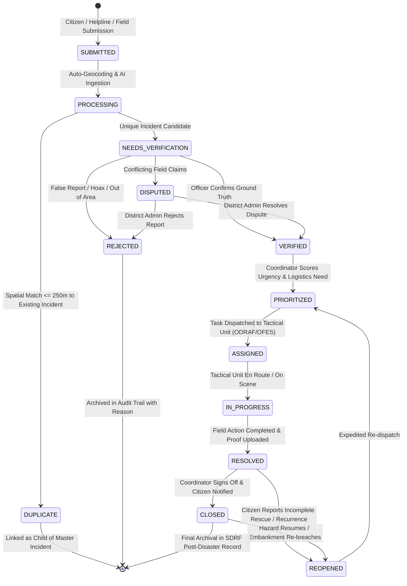
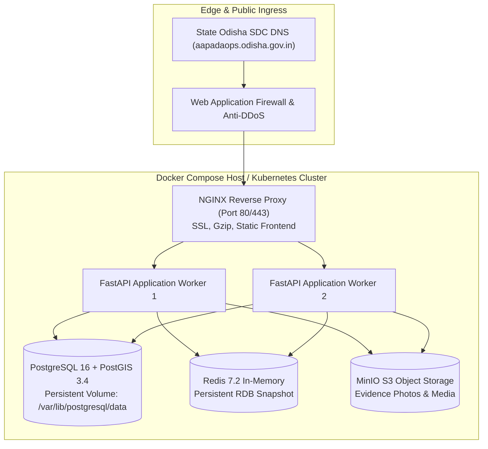

# AapadaOps — Complete System Architecture Specification

**Document Class**: Technical Architecture & Design Document (TADD)  
**System**: AapadaOps (Odisha Disaster-Response Coordination Platform)  
**Author**: Senior Software Architect  
**Version**: 2.0.0 (Prompt 2 Deliverable)  
**Status**: Architecture Frozen for Implementation  

---

## 1. System Architecture Overview

AapadaOps is architected as an asynchronous, event-driven, geospatial web system designed to maintain low latency, data integrity, and operational resilience under disaster conditions.

```
+---------------------------------------------------------------------------------------------------+
|                                        PRESENTATION TIER                                          |
|                                                                                                   |
|   +------------------------------------+   +--------------------------------------------------+   |
|   | EOC Command Console (React 18)     |   | Citizen SOS & Field Responder PWA                |   |
|   | - State/District Dashboard         |   | - Bilingual (Odia + English)                     |   |
|   | - Interactive GIS Map (Leaflet)    |   | - Offline-first Storage (IndexedDB)              |   |
|   | - Verification & Dispatch Board    |   | - Low-bandwidth GPS Geolocation                  |   |
|   +-----------------+------------------+   +------------------------+-------------------------+   |
+---------------------|-----------------------------------------------|-----------------------------+
                      | HTTPS (REST / JSON)                           | WSS (Live Alerts & Events)
                      v                                               v
+---------------------------------------------------------------------------------------------------+
|                                  API GATEWAY & REVERSE PROXY                                      |
|   - NGINX Reverse Proxy / SSL Termination / Rate Limiting (120 req/min for public SOS)             |
|   - Gzip & Brotli Compression / Static Asset Caching                                              |
+---------------------------------------------------------------------------------------------------+
                                                      |
                                                      v
+---------------------------------------------------------------------------------------------------+
|                               APPLICATION TIER (FastAPI Async)                                     |
|                                                                                                   |
|   +----------------------------------+   +----------------------------------------------------+   |
|   | Core API Engine (FastAPI 0.111+) |   | WebSocket Hub & Event Broadcaster                  |   |
|   | - OAuth2 / JWT Auth & RBAC       |   | - Channel Subscriptions (District / Role / Public)  |   |
|   | - Incident Lifecycle Manager     |   | - Client Heartbeat & Reconnection Manager          |   |
|   | - Shelter Logistics Engine       |   +-------------------------+--------------------------+   |
|   | - Task Dispatch Orchestrator     |                             |                              |
|   +-----------------+----------------+                             |                              |
|                     |                                              |                              |
|                     +----------------------+-----------------------+                              |
|                                            |                                                      |
|                                            v                                                      |
|   +-------------------------------------------------------------------------------------------+   |
|   | Domain Logic & AI Pipeline Services                                                       |   |
|   | - Ingestion Service          - Spatial Clustering Engine (DBSCAN 250m)                    |   |
|   | - Verification Service       - AI Urgency Scorer (Advisory only)                          |   |
|   | - Dispatch Service           - CAP Alert Formatter & Broadcast Service                    |   |
|   +-------------------------------------------------------------------------------------------+   |
+--------------------------------------------+------------------------------------------------------+
                                             |
                      +----------------------+----------------------+
                      |                                             |
                      v                                             v
+-------------------------------------------+ +-----------------------------------------------------+
|              PERSISTENCE TIER             | |               STORAGE & CACHE TIER                  |
|                                           | |                                                     |
| PostgreSQL 16 + PostGIS 3.4 Spatial DB    | | Redis 7.2 In-Memory Store                           |
| - WGS 84 (SRID 4326) Geometries           | | - Pub/Sub Event Backplane                           |
| - GIST Spatial Indexes                    | | - Token Blacklist & Session Cache                   |
| - Strict Foreign Keys & Transactions      | | - Rate Limit Counters                               |
| - Tamper-Evident Audit Logs (Append-Only) | |                                                     |
|                                           | | Secure Media File Storage                           |
|                                           | | - Local Disk (Dev) / S3-Compatible MinIO (Prod)     |
|                                           | | - SHA-256 Checksums, Metadata Stripping             |
+-------------------------------------------+ +-----------------------------------------------------+
```

---

## 2. Frontend Architecture

### 2.1. Structural Organization & Design Pattern
The frontend utilizes a **Feature-Slice Architecture** using React 18, TypeScript, Tailwind CSS, and Vite:

```
frontend/src/
├── app/                        # App setup, router, global providers
│   ├── App.tsx                 # Root component with providers
│   ├── routes.tsx              # Declarative route configuration
│   └── store.ts                # Lightweight global UI store (Zustand / Context)
├── components/                 # Shared Government Operations UI Design System
│   ├── layout/                 # AppLayout, TopNav, SidebarNav, StatusBar
│   ├── ui/                     # Accessible Button, Input, Table, Modal, Card, Badge
│   └── feedback/               # AlertBanner, Toast, LoadingSpinner
├── features/                   # Domain Feature Slices
│   ├── auth/                   # Login, Role switcher, Session state
│   ├── eoc/                    # High-density EOC Dashboard & Real-time KPIs
│   ├── map/                    # Leaflet GIS Map, layers (cyclone, flood, shelters)
│   ├── incidents/              # Incident Intake, Verification Queue, Deduplication
│   ├── dispatch/               # Task Board, Tactical Units (ODRAF/OFES) Mobilizer
│   ├── shelters/               # Cyclone Shelter Directory, Capacity & Ration Gauges
│   ├── alerts/                 # CAP Alert Composer & Public Warning Banner
│   └── citizen/                # Bilingual SOS Portal (Odia/En) with Auto-GPS
├── hooks/                      # Custom hooks (useGeolocation, useOnlineStatus, useWebSocket)
├── services/                   # Typed API Client (Axios + TanStack Query)
├── types/                      # TypeScript domain models and API contracts
└── styles/                     # Tailwind CSS and Leaflet custom styling
```

### 2.2. State Management Architecture
1. **Server State**: Managed via `@tanstack/react-query`.
   - Caching: 30-second stale time for high-frequency EOC feeds, automatic background revalidation on window focus.
   - Optimistic Updates: Immediate local state updates during task dispatch and shelter headcount edits.
2. **Client State**: Minimalist global state via `Zustand` / Context:
   - Authenticated user profile, active district scope, map viewport coordinates, and active language (Odia vs. English).
3. **Offline State**: `IndexedDB` stores pending citizen SOS submissions when network drops, draining the queue automatically upon browser `online` event.

### 2.3. Design System Compliance
- **Canvas**: `#f8fafc` (Warm Slate 50).
- **Cards & Tables**: Clean white panels (`#ffffff`) with 1px border (`#e2e8f0`).
- **Accent**: Governance Forest Green (`#166534`, `#15803d`).
- **Alert Levels**:
  - Green (All Clear): `#166534` / bg `#f0fdf4` / border `#bbf7d0`
  - Yellow (Advisory): `#854d0e` / bg `#fefce8` / border `#fef08a`
  - Orange (Warning): `#9a3412` / bg `#fff7ed` / border `#fed7aa`
  - Red (Emergency): `#991b1b` / bg `#fef2f2` / border `#fecaca`
- **Zero Gimmicks**: Strictly zero purple gradients, zero neon glows, zero glassmorphism, zero floating animated cards.

---

## 3. Backend Architecture

### 3.1. Layered Component Boundaries

```
[HTTP / WebSocket Clients]
           |
           v
[FastAPI Router Layer]          --> Validates Pydantic v2 schemas; injects dependencies
           |
           v
[Security & Guard Layer]        --> Verifies JWT, enforces RBAC, checks district tenancy
           |
           v
[Service Layer]                 --> Encapsulates business logic & domain invariants
           |
           +--------------------+--------------------+
           |                                         |
           v                                         v
[AI Processing & Spatial Services]         [Data Access / ORM Layer]
- DBSCAN Spatial Clustering                - SQLAlchemy 2.0 Async
- Entity Extraction & Urgency Scoring      - GeoAlchemy2 Spatial Operators
- PostGIS Buffer & Intersect Queries       - Transactional Session Management
           |                                         |
           +--------------------+--------------------+
                                |
                                v
                   [PostgreSQL 16 + PostGIS 3.4]
```

### 3.2. Synchronous vs. Asynchronous Component Breakdown

| Component | Execution Mode | Rationale & Mechanism |
|---|---|---|
| **Citizen SOS Intake** | **Synchronous HTTP** | Immediate return of unique tracking code (`OD-2026-XXXX`) and receipt confirmation to citizen. |
| **Authentication & Token Issuance** | **Synchronous HTTP** | Sub-50ms validation and JWT encoding. |
| **AI Entity Extraction & Triage** | **Asynchronous Background Task** | Executed in background task pool; writes results to `incident_ai_evaluations` without blocking SOS response. |
| **Spatial Deduplication (DBSCAN)** | **Asynchronous / Fast In-Process** | Executed on incident arrival; clusters points within 250m; updates parent-child relationships. |
| **Verification & Dispatch Mutations** | **Synchronous HTTP with DB Lock** | Pessimistic/row-level lock on incident record to prevent race conditions between two verification officers. |
| **WebSocket Event Broadcast** | **Asynchronous (asyncio + Redis)** | Non-blocking publish to Redis channel; dispatched to active connected WebSocket clients. |
| **SitRep Report Compilation** | **Synchronous Stream / Cached** | Aggregated SQL query returned as formatted JSON/PDF within 200ms. |

---

## 4. User Roles & Permission Matrix

AapadaOps defines **7 distinct user roles** with strict hierarchical boundaries:

```
Super Administrator
  └── District Administrator
        ├── Incident Verification Officer
        └── Response Coordinator
              └── Field Worker
```
*(Read-only Observer and Citizen Reporter operate orthogonal to this administrative chain)*

### Detailed Role Definitions & Permissions

| Role | Operational Responsibility | Allowed System Actions | Forbidden Actions |
|---|---|---|---|
| **Super Administrator** | Statewide system governance & OSDMA IT command | • Full system config & tenant setup<br>• Manage all user accounts & roles<br>• Access full audit log<br>• Statewide alert broadcast | • Cannot alter historical audit logs (append-only) |
| **District Administrator** | District Collector / Additional District Magistrate (ADM) | • District alert broadcast<br>• Activate/deactivate cyclone shelters<br>• Mobilize tactical assets across blocks<br>• Resolve disputed incidents<br>• Sign off district SitReps | • Cannot modify other districts' assets or users<br>• Cannot alter system-wide security settings |
| **Incident Verification Officer** | Tahasildar, Revenue Inspector (RI), DEOC Desk Officer | • Review unverified incident queue<br>• Mark incidents as `VERIFIED` or `REJECTED`<br>• Link reports as `DUPLICATE` of a parent<br>• Flag incidents as `DISPUTED` | • Cannot dispatch tactical rescue units<br>• Cannot close incidents without field resolution |
| **Response Coordinator** | BDO, Fire Services Officer, ODRAF Operations Head | • Prioritize verified incidents (`PRIORITIZED`)<br>• Create administrative tasks<br>• Assign tactical units to tasks (`ASSIGNED`)<br>• Reassign or reallocate assets | • Cannot reject citizen incidents without verification officer sign-off |
| **Field Worker** | ODRAF Team Lead, Fire Station Officer, Aapda Mitra | • View assigned tasks on mobile PWA<br>• Update task state (`EN_ROUTE`, `ON_SCENE`, `RESOLVED`)<br>• Upload photo proof & geotagged notes<br>• Update shelter headcounts | • Cannot verify reports from unassigned sectors<br>• Cannot broadcast public alerts |
| **Read-only Observer** | Line Dept Secretary, NDMA Liaison, Media Officer | • View aggregated EOC dashboards<br>• Inspect public hazard maps<br>• Download completed SitReps | • Zero write, edit, or dispatch permissions |
| **Citizen Reporter** | General public in affected areas | • Submit new SOS report with GPS & photo<br>• View status of own submitted SOS<br>• View active public warnings & safe shelters | • Zero access to internal verification queues, tactical inventory, or officer details |

---

## 5. Incident Lifecycle State Machine

The incident lifecycle governs every distress report from initial submission to final administrative closure:



### Lifecycle Transition Rules

| State | Allowed Next States | Authorized Actors | Required Input / Invariant |
|---|---|---|---|
| `SUBMITTED` | `PROCESSING` | System (Automated) | Valid GPS coordinates or Odisha district code. |
| `PROCESSING` | `NEEDS_VERIFICATION`, `DUPLICATE` | System (Automated) | Ingestion and spatial clustering execution. |
| `NEEDS_VERIFICATION` | `VERIFIED`, `REJECTED`, `DISPUTED` | Incident Verification Officer | Verification notes or mandatory rejection reason code. |
| `DUPLICATE` | Linked to Parent | Incident Verification Officer | Must reference valid `parent_incident_id`. |
| `DISPUTED` | `VERIFIED`, `REJECTED` | District Administrator | Mandatory escalation resolution remarks. |
| `VERIFIED` | `PRIORITIZED` | Response Coordinator | Urgency tier confirmation (Critical / High / Med / Low). |
| `PRIORITIZED` | `ASSIGNED` | Response Coordinator | Valid `assigned_unit_id` and SLA deadline. |
| `ASSIGNED` | `IN_PROGRESS` | Assigned Field Worker / Unit | Timestamp when unit moves to `EN_ROUTE` or `ON_SCENE`. |
| `IN_PROGRESS` | `RESOLVED` | Assigned Field Worker / Unit | Resolution summary, persons rescued count, photo evidence. |
| `RESOLVED` | `CLOSED`, `REOPENED` | Response Coordinator / Citizen | Satisfaction verification or citizen re-trigger. |
| `REOPENED` | `PRIORITIZED` | Response Coordinator | Immediate high-priority queue placement. |

---

## 6. Separation of AI Inferences from Verified Human Decisions

To uphold the core project principle of safety and human accountability, **AI is strictly decision-support, never autonomous execution**:

```
+-----------------------------------------------------------------------------------+
|                        AI / HUMAN SEPARATION BOUNDARY                             |
+-----------------------------------------------------------------------------------+
|                                                                                   |
|  [AUTOMATED AI ADVISORY LAYER]               [AUTHORIZED HUMAN DECISION LAYER]    |
|                                                                                   |
|  - Entity Extraction (Stranded count,        - Incident Verification Officer:     |
|    water depth, vulnerable persons)            Reviews raw text, photos, and      |
|  - Advisory Urgency Score (0.0 to 1.0)         AI extraction. Explicitly clicks   |
|  - Spatial Clustering Suggestion               "VERIFY" or "REJECT".              |
|    (Flags potential duplicate)                                                    |
|                                              - Response Coordinator:              |
|                                                Confirms priority and explicitly   |
|                                                assigns tactical unit.             |
|                                                                                   |
|                  |                                         ^                      |
|                  | Writes strictly to                      | Reads advice from    |
|                  v                                         |                      |
|  +---------------------------------+     +---------------------------------+      |
|  |   incident_ai_evaluations       |     |   incidents & tasks tables      |      |
|  |   (Separate table, advisory)    |     |   (Ground truth, human signed)  |      |
|  +---------------------------------+     +---------------------------------+      |
+-----------------------------------------------------------------------------------+
```

### Concrete Architectural Safeguards:
1. **Schema Partitioning**: AI predictions are stored in an auxiliary table (`incident_ai_evaluations`) or with explicit `ai_` column prefixes (`ai_suggested_priority`, `ai_confidence`). The authoritative `status` and `priority` columns on the `incidents` table can **only** be modified by an authenticated human user session.
2. **UI Visual Demarcation**: In the frontend, all AI-generated outputs are clearly framed in a neutral slate container tagged with a badge: `[AI Decision Support — Unverified]`. The rationale is spelled out in plain text (e.g. *"Entity extracted: 'water neck deep' (Confidence: 0.92)"*).
3. **No Autonomous Dispatch**: Under no circumstances does an AI prediction dispatch a rescue boat or alter shelter evacuation orders.

---

## 7. Database Entity Relationship Model (PostgreSQL 16 + PostGIS)

```mermaid
erDiagram
    DISTRICTS ||--o{ BLOCKS : contains
    DISTRICTS ||--o{ USERS : assigns
    DISTRICTS ||--o{ CYCLONE_SHELTERS : locates
    DISTRICTS ||--o{ INCIDENTS : bounds
    DISTRICTS ||--o{ TACTICAL_UNITS : stations
    DISTRICTS ||--o{ ALERTS : targets

    BLOCKS ||--o{ CYCLONE_SHELTERS : manages
    BLOCKS ||--o{ INCIDENTS : contains

    USERS ||--o{ INCIDENTS : verifies
    USERS ||--o{ TASKS : assigns
    USERS ||--o{ ALERTS : creates
    USERS ||--o{ AUDIT_LOGS : performs

    INCIDENTS ||--o{ INCIDENTS : clusters_child
    INCIDENTS ||--o| INCIDENT_AI_EVALUATIONS : advises
    INCIDENTS ||--o{ TASKS : generates
    INCIDENTS ||--o{ FILE_UPLOADS : attaches

    TACTICAL_UNITS ||--o{ TASKS : executes
    CYCLONE_SHELTERS ||--o{ SHELTER_SUPPLY_LOGS : records

    DISTRICTS {
        uuid id PK
        string code UK
        string name
        string name_odia
        geometry center_point
        geometry boundary_geom
    }

    BLOCKS {
        uuid id PK
        uuid district_id FK
        string name
        string name_odia
        geometry boundary_geom
    }

    USERS {
        uuid id PK
        string email UK
        string hashed_password
        string full_name
        string phone
        string role
        uuid district_id FK
        boolean is_active
        datetime created_at
    }

    CYCLONE_SHELTERS {
        uuid id PK
        string code UK
        string name
        uuid district_id FK
        uuid block_id FK
        geometry location_point
        int total_capacity
        int current_occupancy
        string status
        boolean has_dg_set
        float dg_fuel_hours
        int water_litres
        int dry_ration_days
        string contact_name
        string contact_phone
    }

    INCIDENTS {
        uuid id PK
        string incident_code UK
        string source
        string status
        string caller_name
        string caller_phone
        geometry location_point
        string address_text
        uuid district_id FK
        uuid block_id FK
        string hazard_type
        string verified_priority
        int persons_stranded
        boolean has_vulnerable_people
        text raw_description
        uuid parent_incident_id FK
        uuid verified_by_id FK
        datetime verified_at
        text rejection_reason
        text dispute_notes
        datetime created_at
        datetime updated_at
    }

    INCIDENT_AI_EVALUATIONS {
        uuid id PK
        uuid incident_id FK UK
        string detected_hazard
        float confidence_score
        jsonb extracted_entities
        string suggested_priority
        float duplicate_confidence
        uuid suggested_parent_id FK
        datetime evaluated_at
    }

    TASKS {
        uuid id PK
        string task_code UK
        uuid incident_id FK
        string title
        string priority
        uuid assigned_unit_id FK
        uuid assigned_by_id FK
        string status
        datetime sla_deadline
        text ground_report
        datetime resolved_at
        datetime created_at
    }

    TACTICAL_UNITS {
        uuid id PK
        string unit_code UK
        string name
        string organization
        uuid district_id FK
        geometry current_location
        string status
        string commander_name
        string commander_phone
        jsonb equipment_summary
    }

    ALERTS {
        uuid id PK
        string alert_code UK
        string hazard_type
        string severity_tier
        string title_en
        string title_or
        text description_en
        text description_or
        jsonb target_district_ids
        geometry target_geometry
        datetime effective_from
        datetime expires_at
        uuid created_by_id FK
        string status
    }

    AUDIT_LOGS {
        uuid id PK
        datetime timestamp
        uuid operator_id FK
        string action
        string entity_type
        uuid entity_id
        jsonb previous_state
        jsonb new_state
        string ip_address
    }

    FILE_UPLOADS {
        uuid id PK
        string original_filename
        string storage_path
        string mime_type
        int file_size_bytes
        string sha256_hash
        uuid uploader_id FK
        string entity_type
        uuid entity_id
        string virus_scan_status
        datetime created_at
    }
```

---

## 8. REST API Specification (OpenAPI Contract)

Base URL: `/api/v1`

### 8.1. Authentication & Profile (`/auth`)
- `POST /auth/login` (Public): Returns JWT access and refresh tokens.
- `POST /auth/refresh` (Public with Refresh Token): Returns refreshed access token.
- `GET /auth/me` (Authenticated): Returns caller's profile, role, and district jurisdiction.

### 8.2. Incidents & SOS (`/incidents`)
- `POST /incidents` (Public / Citizen): Submit emergency SOS. Returns `201 Created` with tracking code `OD-YYYY-XXXX`.
- `GET /incidents` (Authenticated): Paginated, filterable collection. Query params: `district_id`, `status`, `priority`, `hazard_type`, `parent_only=true`.
- `GET /incidents/{id}` (Authenticated): Detailed incident view with linked duplicate children, AI advisory evaluation, and task dispatches.
- `PATCH /incidents/{id}/verify` (Verification Officer / Admin): Transition status to `VERIFIED` or `REJECTED`. Body: `{ "status": "VERIFIED", "priority": "HIGH", "verification_notes": "..." }`.
- `POST /incidents/{id}/cluster-duplicate` (Verification Officer): Link this incident as a child of an existing parent incident. Body: `{ "parent_incident_id": "<uuid>" }`.
- `PATCH /incidents/{id}/dispute` (Verification Officer): Mark report as disputed with reasons.

### 8.3. Tasks & Force Dispatch (`/tasks`)
- `GET /tasks` (Authenticated): List administrative dispatch tasks.
- `POST /tasks` (Response Coordinator / Admin): Create new dispatch task from a verified incident. Body: `{ "incident_id": "<uuid>", "assigned_unit_id": "<uuid>", "priority": "CRITICAL", "sla_hours": 2 }`.
- `PATCH /tasks/{id}/status` (Field Worker / Coordinator): Update task state (`EN_ROUTE`, `ON_SCENE`, `RESOLVED`). Body: `{ "status": "RESOLVED", "ground_report": "Rescued 14 villagers via BAUT-02", "persons_rescued": 14 }`.

### 8.4. Multi-Purpose Cyclone Shelters (`/shelters`)
- `GET /shelters` (Public / Authenticated): List shelters with capacity, occupancy rate, and distance from user GPS.
- `GET /shelters/{id}` (Authenticated): Detailed lifeline metrics (water liters, ration days, DG fuel hours).
- `PATCH /shelters/{id}/logistics` (CSMMC / Field Worker / Coordinator): Update shelter occupancy and lifeline supplies.

### 8.5. Early Warning & CAP Alerts (`/alerts`)
- `GET /alerts/active` (Public): List active public alerts categorized by Green, Yellow, Orange, Red tiers.
- `POST /alerts` (District / State Admin): Create and broadcast CAP-compliant emergency alert. Body: `{ "severity_tier": "ORANGE", "hazard_type": "CYCLONE", "title_en": "...", "title_or": "...", "target_district_ids": ["..."] }`.

### 8.6. Geospatial GIS Data (`/gis`)
- `GET /gis/districts` (Public): GeoJSON boundaries of Odisha's 30 districts.
- `GET /gis/flood-zones` (Public): GeoJSON polygons of active river basin inundation hazard zones.
- `GET /gis/incidents-heatmap` (Authenticated): GeoJSON feature collection of active verified incidents for heat-mapping.

### 8.7. Operations Analytics & SitRep (`/analytics`)
- `GET /analytics/eoc-summary` (Authenticated): Real-time executive KPIs (active incidents, evacuated citizens, shelter occupancy rate, deployed teams).
- `GET /analytics/sitrep` (Authenticated): Standardized Situation Report formatted for export.

---

## 9. Real-Time Event Architecture (WebSockets + Redis)

```
[FastAPI Backend Action]
        |
        v
[Redis Pub/Sub Channel] --> (e.g. "districts:puri:events")
        |
        v
[WebSocket Hub (FastAPI)]
        |
        +---> [Connected EOC Operators (District: Puri)]
        +---> [Connected Tactical Field Units (ODRAF Unit 04)]
        +---> [Connected Command Video Wall]
```

### Event Message Format (JSON)
```json
{
  "event_type": "INCIDENT_VERIFIED",
  "district_id": "9b1deb4d-3b7d-4bad-9bdd-2b0d7b3dcb6d",
  "payload": {
    "incident_id": "f47ac10b-58cc-4372-a567-0e02b2c3d479",
    "incident_code": "OD-2026-0492",
    "hazard_type": "FLOOD_TRAPPED",
    "priority": "CRITICAL",
    "latitude": 19.8135,
    "longitude": 85.8312,
    "timestamp": "2026-11-12T00:25:00Z"
  }
}
```

---

## 10. File Storage Architecture

```
[Client Multi-part Upload]
           |
           v
[Upload Validator] --> File size limit check (<= 10MB)
           |       --> MIME sniff (valid image/jpeg, image/png, video/mp4)
           v
[Hash & Deduplication] --> Calculate SHA-256; check if identical file exists
           |
           v
[Metadata Sanitizer] --> Strip unneeded EXIF headers; extract GPS if present
           |
           v
[Storage Backend]
├── Development: Local volume `./uploads/{entity_type}/{uuid}_{filename}`
└── Production: MinIO / S3 bucket `s3://aapadaops-evidence/`
```

---

## 11. Deployment Architecture (Docker & Cloud Orchestration)



---

## 12. Implementation Sequence

To ensure systematic, testable progress:

1. **Step 1 (Data Persistence & ORM)**:
   - Create declarative SQLAlchemy 2.0 models for all 10 entities.
   - Build seed script with realistic Odisha baseline data (30 districts, coastal blocks, cyclone shelters, tactical units).
2. **Step 2 (Core REST API Endpoints & Auth)**:
   - Implement authentication, RBAC dependencies, and JWT flow.
   - Build CRUD and state transition endpoints for `/incidents`, `/tasks`, and `/shelters`.
3. **Step 3 (AI Triage & Deduplication Engine)**:
   - Implement spatial clustering service using Haversine/DBSCAN.
   - Implement bilingual entity extraction and urgency scoring service.
4. **Step 4 (Frontend Government Operations UI & Map)**:
   - Build accessible component library adhering to design tokens.
   - Implement Leaflet GIS interactive map with district boundaries and hazard overlays.
5. **Step 5 (Operational Workflows & Dispatch Board)**:
   - Build BDO/Collector Verification Queue and Deduplication Merger UI.
   - Implement Tactical Task Dispatch Board and Shelter Logistics Cockpit.
6. **Step 6 (Citizen Portal, Testing & Verification)**:
   - Bilingual mobile-first SOS form with GPS auto-detection.
   - End-to-end integration test suite and SitRep generation verification.
